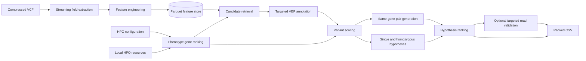

# System Architecture

## Design goals

- Scan the genome-scale input once and reuse columnar intermediate data.
- Separate candidate retrieval from candidate ranking.
- Preserve competing inheritance hypotheses until final rank aggregation.
- Annotate only retrieved candidates rather than the complete VCF.
- Keep every transformation reproducible from configuration and scripts.
- Keep controlled genomic data outside the source repository.

## Component diagram



## Processing layers

### 1. Ingestion

`scripts/01_extract_vcf_features.sh` streams selected VCF fields into a compact
tabular projection. This isolates downstream processing from repeated VCF
parsing.

### 2. Feature store

`src/features/build_vcf_features.py` converts the projection into typed Parquet
and derives reusable fields such as:

- normalized chromosome and variant key;
- genotype class;
- reference and alternate depth;
- sample depth and genotype quality;
- variant allele fraction;
- variant type and filter status;
- technical-quality score;
- local phase identifiers.

The complete feature store is immutable input for all retrieval branches.

### 3. Phenotype retrieval

`src/phenotype/rank_genes.py` loads the local HPO ontology, gene annotations and
`configs/proband.yaml`. It produces a ranked gene table using semantic
similarity, information content and phenotype-group coverage.

The phenotype rank is a retrieval and ranking feature, not a destructive
filter.

### 4. Candidate retrieval and annotation

Candidate preparation scripts intersect ranked genes with coding and splice
regions, apply configurable technical thresholds and emit a normalized
candidate VCF.

Targeted VEP annotation adds:

- gene and transcript identifiers;
- consequence and impact;
- coding and protein notation;
- population-frequency evidence;
- known clinical classifications.

Only the retrieved candidate set is annotated.

### 5. Variant scoring

`src/ranking/rank_candidates.py` converts annotations into normalized component
scores:

- technical quality;
- population rarity;
- functional consequence;
- clinical evidence;
- phenotype relevance.

The module also generates same-gene heterozygous pairs and applies pair-level
quality controls, including known-cis exclusion and local-cluster protection.

### 6. Hypothesis ranking

`src/ranking/rank_hypotheses.py` represents candidates as competing hypotheses:

- compound heterozygous;
- homozygous;
- single heterozygous;
- secondary review candidates.

It applies inheritance-aware adjustments, removes duplicate representations,
diversifies the final list and converts selected hypothesis scores into EPCR
values.

### 7. Validation and output

Targeted read alignment is an optional validation layer applied only to
shortlisted variants. It does not participate in genome-wide candidate
generation.

`scripts/08_validate_submission.py` validates the generated CSV contract before
upload.

## Data flow

```text
VCF
  -> compressed field projection
  -> typed Parquet feature store
  -> phenotype-guided candidate retrieval
  -> normalized candidate VCF
  -> targeted VEP table
  -> scored variants and pairs
  -> ranked inheritance hypotheses
  -> submission CSV
```

Each stage writes a persistent intermediate artifact. Expensive stages can
therefore be rerun independently without rescanning or reannotating the full
input.

## Configuration

`configs/proband.yaml` contains case-specific phenotype groups, weights and
retrieval thresholds.

`configs/known_mva_seed_genes.txt` is a small pipeline-validation input. It is
kept separate from phenotype-driven retrieval so positive-control execution
does not alter the primary ranking path.

## Repository structure

| Path | Responsibility |
|---|---|
| `configs/` | Case and retrieval configuration |
| `scripts/` | Reproducible command-line orchestration |
| `src/features/` | VCF normalization and technical feature engineering |
| `src/phenotype/` | Local phenotype-to-gene ranking |
| `src/ranking/` | Variant, pair and hypothesis ranking |
| `tests/` | Unit tests for feature and phenotype logic |
| `submission/` | Final generated submission artifacts |
| `docs/` | Detailed data, feature and experiment documentation |

## Storage boundaries

Genome-scale and sample-level artifacts remain in ignored local directories:

```text
data/
results/
resources/
vep_data/
vep_output/
```

The repository contains code, configuration, documentation and approved final
outputs only.

## Extension points

Additional retrieval or scoring branches can consume the Parquet feature store
and publish hypotheses to the same aggregation layer. Examples include:

- CNV and structural-variant candidates;
- calibrated pathogenicity predictors;
- pedigree-aware segregation features;
- multi-lane read-support features;
- learned ranking models.

New branches should preserve the normalized variant identity and hypothesis
schema so they can be compared without changing the output layer.
