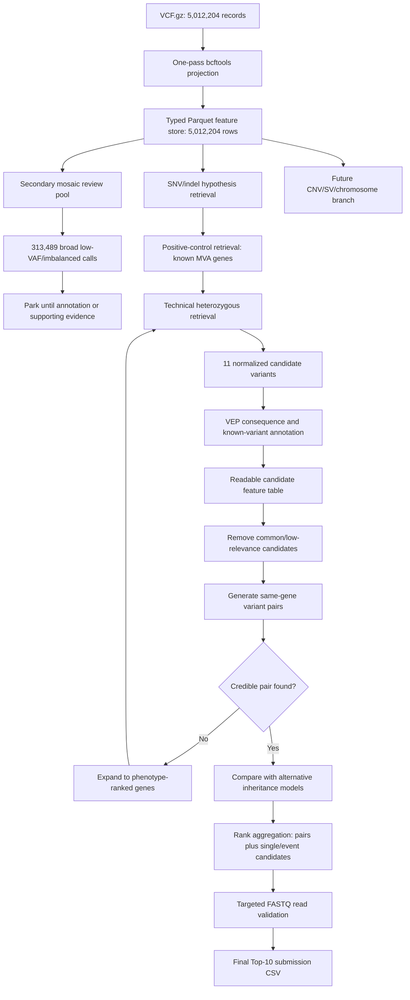

# Track 1 Architecture and Current Status

## Objective

Rank the specific GRCh38 variant or compound-heterozygous variant pair driving the
proband's condition. The final deliverable is not a filtered VCF. It is a maximum
of 10 ranked submission rows, accompanied by a GitHub repository and a methods
report. The repository may remain private during the hackathon under the current
Track 1 instructions and must be public when judging requires it.

## Official Track 1 contract

The public Track 1 implementation accepts:

```text
proband_id,chrom_1,pos_1,ref_1,alt_1,
chrom_2,pos_2,ref_2,alt_2,
epcr,finding_type,notes
```

Rules relevant to the pipeline:

- `proband_id` is `PROBAND01`.
- Coordinates and alleles must use GRCh38.
- At most 10 rows are accepted.
- A single-variant hypothesis uses only the first variant columns.
- A compound-heterozygous hypothesis puts both variants in the same row.
- `epcr` must be in `(0, 1]` and controls ranking.
- `finding_type` is `primary` or `secondary`.
- A GitHub URL and PDF/Markdown methods report are required.
- Each participant has six submissions; the best score appears on the leaderboard.

The public scoring implementation explicitly describes its production answer key
as compound heterozygous and contains partial-credit logic for one of two
variants. This is organizer-authored metadata, not an independent conclusion
from our VCF analysis. We therefore prioritize the pair hypothesis while testing
single-variant, homozygous, mosaic and CNV/SV alternatives in parallel.

## System architecture



## The reductions so far

These are parallel views of the data, not one destructive filter chain.

| Dataset | Rows | Meaning |
|---|---:|---|
| Complete VCF | 5,012,204 | Original candidate universe |
| Technical Parquet | 5,012,204 | Reusable typed feature store; no variants removed |
| Mosaic review pool | 313,489 | Broad heterozygous calls with DP >= 20, alternate depth >= 4 and VAF 0.05-0.35 |
| MVA positive-control pool | 11 | Heterozygous variants in three literature-derived MVA genes |

### Why 313,489 is not the primary candidate count

The mosaic rule intentionally has high recall. Its median VAF is 0.25, median GQ
is 99, 220,327 rows are PASS, and 157,679 have dbSNP identifiers. Most are likely
ordinary germline heterozygous calls with read imbalance. This pool remains
available for later evidence-driven analysis but is not being sent wholesale to
VEP.

### How the 11 positive-control candidates were produced

```text
5,012,204 complete variants
    -> genomic regions for BUB1B, CEP57 and TRIP13
    -> normalize and split alleles
    -> heterozygous genotype
    -> sample DP >= 8
    -> GQ >= 20
    -> alternate depth >= 3
    -> 11 candidates
```

Observed distribution:

| Gene region | Candidate count |
|---|---:|
| `TRIP13` | 1 |
| `CEP57` | 2 |
| `BUB1B` | 8 |

This set was selected from prior knowledge of the disease label, not inferred
from the proband. Its purpose was to verify the region extraction, normalization
and VEP pipeline cheaply. It is not the primary unbiased candidate search and
cannot prove that the causal variant or pair is among these 11.

## What VEP contributes

The raw VCF already supplies technical evidence:

- chromosome, position, reference and alternate alleles
- genotype, allele depth, total depth and genotype quality
- mapping and strand-quality metrics
- local phase fields where present

VEP adds ranking features that are absent from the raw technical call:

- gene and transcript
- functional consequence
- impact category
- coding/protein HGVS
- canonical and MANE transcript status
- existing variant identifiers
- population frequencies from available cache resources
- maximum population frequency
- clinical significance where available

VEP does not decide causality. It transforms each retrieved variant into a richer
feature row so common intronic variants rank below rare damaging or splice-related
variants.

Current VEP output:

```text
~/vep_output/targeted_candidates.vep.vcf.gz
```

It contains all 11 positive-control records and the expected `CSQ` schema.

## Current position

```text
[done] Full VCF technical extraction
[done] Parquet feature engineering
[done] Broad mosaic pool creation
[done] Known-MVA positive-control extraction
[done] VEP cache/reference setup
[done] VEP annotation of 11 candidates
[done] Local HPO semantic gene ranking
[done] Top-500 coding/splice retrieval and ranking
[done] Top-2000 sensitivity retrieval and ranking
[done] Inheritance-aware hypothesis comparison
[done] Pair artifact, cis, HLA and conflicting-classification QC
[done] Ten-row Track 1 CSV preparation and validation
[done] Methods report preparation
[done] Lane-1 R1 validation of both BUB1B alleles
[not completed] Paired-end and all-lane validation
[ready] Upload Submission 1 with repository URL and report
```

## Submission-ready outputs

```text
submission/ask-kausheek_hpo-vep-rankfusion.csv
submission/ask-kausheek_track1_report.md
```

The final checklist and repository allowlist are in
[SUBMISSION_CHECKLIST.md](SUBMISSION_CHECKLIST.md).

See [Inheritance hypothesis testing](HYPOTHESIS_TESTING.md) for the evidence
required before preferring a pair over single-variant, homozygous, mosaic or
CNV/SV hypotheses.

## Implemented pipeline

### 1. Positive-control candidate analysis

Produce one row per annotated variant and assign interpretable component scores:

- technical quality
- population rarity
- functional consequence
- clinical evidence
- transcript relevance

### 2. Compound-heterozygous pair generation

Join heterozygous candidates to other candidates in the same gene. Pair features:

- combined rarity
- combined consequence severity
- whether both variants are credible calls
- local phase compatibility from `PGT/PID`
- phenotype relevance of the gene

Two variants known to be in cis should be penalized or excluded from a
compound-heterozygous hypothesis. Unphased finalists require additional evidence.

### 3. Phenotype expansion

Use the eight supplied HPO terms to rank genes. The strongest case-specific
features include cancer predisposition, growth restriction, muscle phenotype,
nephrocalcinosis and recurrent pregnancy loss. The result is a ranked retrieval
list, not a biology-only hard filter.

The local baseline uses HPO semantic similarity plus phenotype-group coverage.
No clinical data is sent to an external service.

### 4. Ranking

Rank candidates independently by:

- rarity
- consequence
- clinical/pathogenicity evidence
- phenotype relevance
- technical evidence
- pair compatibility

Combine normalized phenotype, consequence, rarity, clinical and technical
component scores, then apply inheritance-aware hypothesis adjustments. Compare
the clinical-prior HPO configuration against an equal-HPO-weight ablation.

### 5. FASTQ validation

The four paired-end lanes are deferred until a small shortlist exists. They are
used to:

- confirm alternate-read support;
- inspect strand and positional balance;
- investigate suspicious low-VAF candidates;
- help determine whether paired variants are on different haplotypes;
- investigate chromosome/CNV evidence if required.

FASTQs are a validation and evidence source, not the first candidate-generation
stage.

### 6. Submission generation

The final CSV should contain the best-supported pair at rank 1 if evidence
supports it, followed by alternative pairs or single-variant hypotheses. EPCR
values must be strictly descending enough to create useful F-max thresholds.
Weak secondary findings should not be assigned confidence comparable to primary
hypotheses.

## Artifacts

| Artifact | Location |
|---|---|
| Complete technical features | `data/full/processed/vcf_features.parquet` |
| Broad mosaic pool | `data/full/processed/mosaic_review.parquet` |
| Positive-control regions | `data/annotation/tier1/gene_regions.bed` |
| Positive-control pre-VEP candidates | `data/annotation/tier1/targeted_candidates.vcf.gz` |
| Positive-control VEP output | `~/vep_output/targeted_candidates.vep.vcf.gz` |
| Positive-control readable table | `~/vep_output/tier1_candidates.tsv` |

Raw genomic data and individual-level derived tables must remain local and must
not be committed to the GitHub repository.
